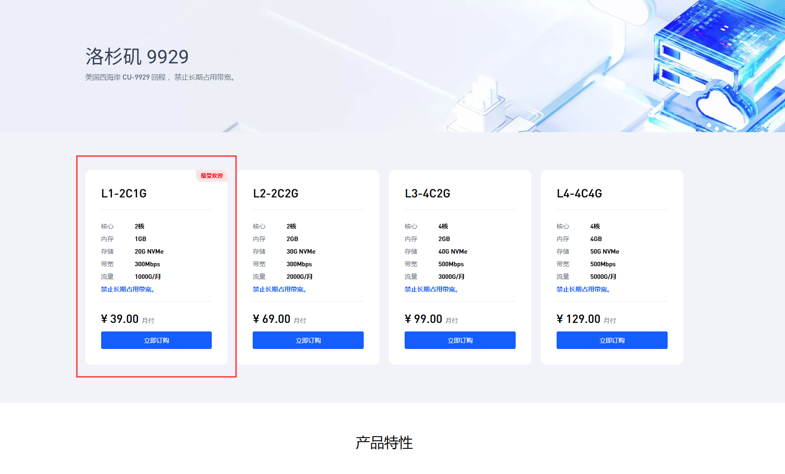
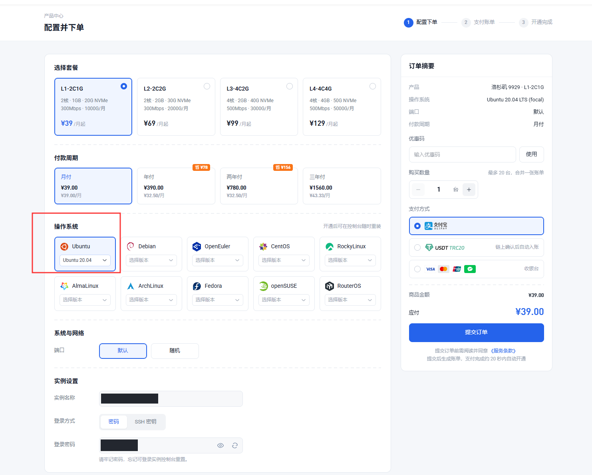
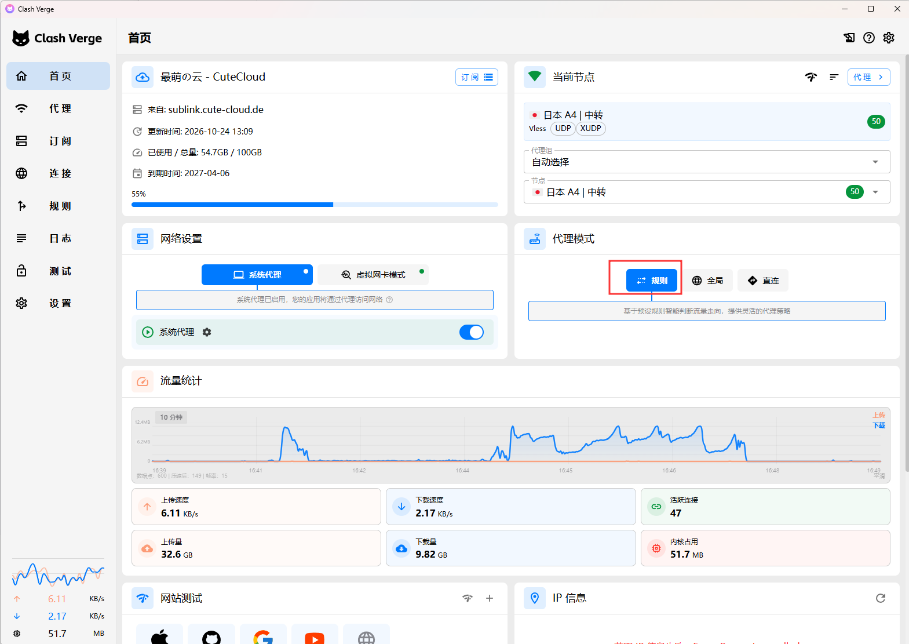
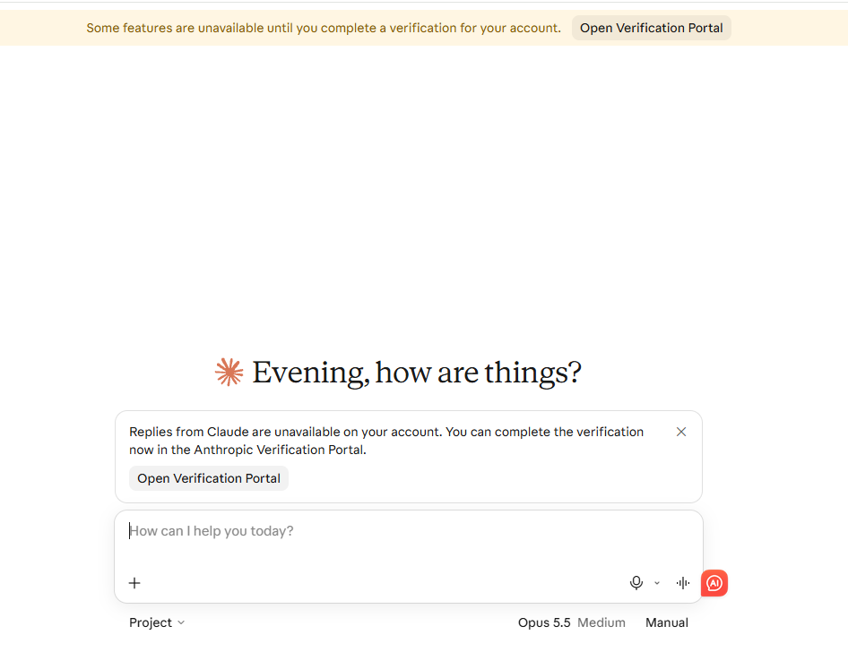
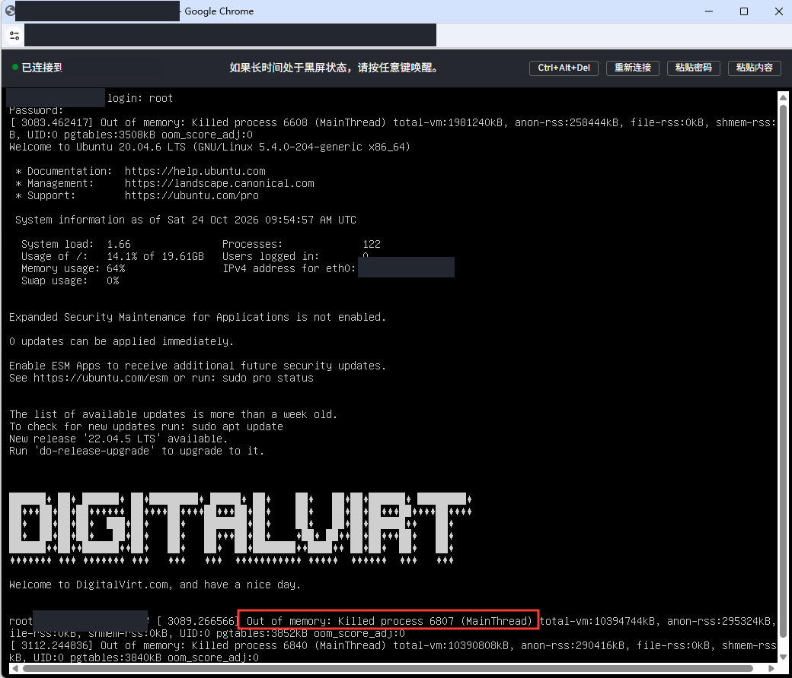
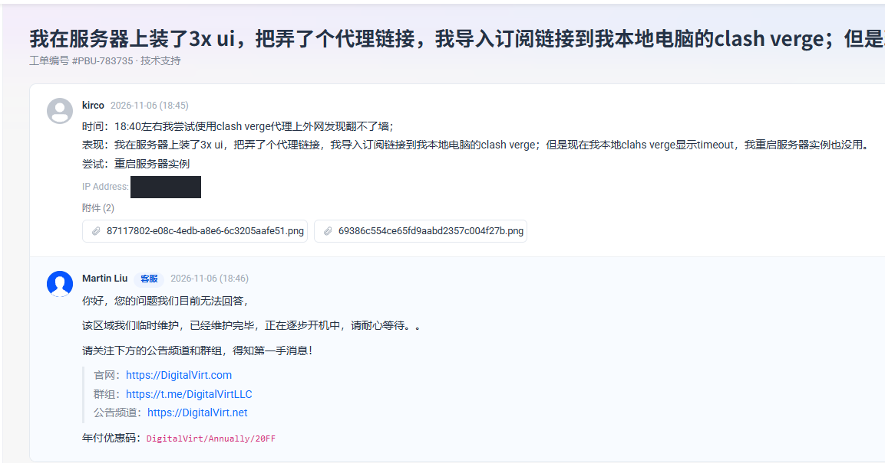
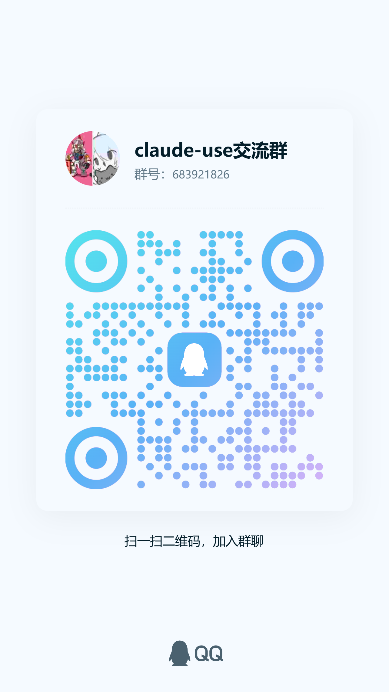

# A beginner's guide to Claude Code

[简体中文](README.md) · English

I've written this as three steps. If you need to set up a proxy on a network you're authorized to configure, start with the VPS. If your connection already works, skip to step 3 to subscribe to Pro and sign into Claude Code.

## 1. Rent a VPS

**Where to rent the VPS (referral link)**　<https://digitalvirt.com/aff.php?aff=1572>

1. Open the link and find **Los Angeles 9929** in the product list. The red box below shows the **¥39 per month** entry tier. If it sells out and you want the same line right away, choose a higher-priced tier that's still in stock. Check the price and availability on the product page before ordering.

   

2. On the order page, choose **Ubuntu** under **Operating System**. Check that the provider offers a browser console, then choose a billing period and place your order. The browser console lets you check the server if SSH drops or won't connect.

   

3. After the VPS is provisioned, find the server address, SSH port, and login details in the provider's dashboard. Connect from your computer over SSH or open the browser console. Make sure you can open a shell before you install the panel.

## 2. Export a 3x-ui subscription and import it into Clash Verge

1. **Install the panel.** Follow the project instructions to install **3x-ui** on a VPS you administer. Sign into the panel, set up an inbound and a client for your device, and check that Xray is running.

   - Install 3x-ui　<https://github.com/MHSanaei/3x-ui/wiki/Installation>
   - Inbound configuration　<https://github.com/MHSanaei/3x-ui/blob/main/docs/content/docs/en/config/inbounds.mdx>

2. **Copy the subscription link.** Enable subscriptions under **Panel Settings → Subscription**, then copy the **subscription link** for your client. Choose the Clash format if the panel offers it. This link gives Clash Verge your node configuration. Keep it on your own devices.

   - Subscription settings　<https://github.com/MHSanaei/3x-ui/wiki/Common-questions-and-problems#13-how-does-the-panel-subscription-link-work>

3. **Import and activate it.** Install **Clash Verge Rev** on your computer and open **Subscriptions**. Paste the URL, import it, and select the new profile. Check that the node appears under **Proxies**, then select **Rule** mode and enable **System Proxy** as shown below. Open a site you're allowed to access and check the client's connections list to see which rule matched.

   - Download Clash Verge Rev　<https://www.clashverge.dev/install.html>
   - Import a subscription　<https://www.clashverge.dev/guide/profile.html>

   

## 3. Subscribe to Pro and sign into Claude Code

1. **Subscribe to Pro.** Sign into Claude on the web with your own account. If you're new to Claude, follow the prompts to sign up with your own email address. Open your profile menu in the lower left and go to **Settings → Billing → Upgrade plan**. Choose **Pro**, review the monthly or annual price, and complete checkout.

   - Claude on the web　<https://claude.ai/>
   - How to subscribe to Pro　<https://support.claude.com/en/articles/8325609-how-do-i-sign-up-for-the-pro-plan>

2. **Complete KYC if prompted.** If your account shows a prompt like the one below, select **Open Verification Portal** or use the link offered in your account. Follow the on-screen instructions after verification. If it fails or your account remains restricted, use the Help Center to contact support or appeal.

   - Verification and appeals　<https://support.claude.com/en/articles/14328960-identity-verification-on-claude>

   

3. **Use the same account in Claude Code.** Once Pro is active, install Claude Desktop from the official site, sign in, open the **Code** tab, and choose a project folder. If you prefer a terminal, install the CLI using the official quickstart, run `claude` in your project directory, and sign in with that same account.

   - Desktop download　<https://claude.com/download>
   - CLI quickstart　<https://code.claude.com/docs/en/quickstart>
   - Using Claude Code with Pro　<https://support.claude.com/en/articles/11145838-use-claude-code-with-your-pro-max-or-ultra-plan>

## Stuck? Start where it first fails

| Problem | What to check next |
| --- | --- |
| SSH keeps dropping | Open the provider's browser console. Use `free -h` to check memory and `sudo journalctl -k --since today` to look for out-of-memory (OOM) messages near the time of the drop. If memory is tight, ask for setup help on your own computer and leave the VPS resources for the proxy service. |
| The subscription won't import or lists no nodes | Make sure the subscription service is on, the client is enabled and still valid, and your computer can reach the subscription URL. If you see a certificate error, check the domain and certificate. |
| The node appears but shows `timeout` | Check that the VPS is online and the service is listening on the right port. Verify that the network rules allow it. If it still times out, check the provider's incident notices or open a ticket to ask about maintenance. |
| Only Claude Code has trouble connecting | Check the Claude status page, confirm you're signed into the account with Pro, and check your client's network settings. The CLI reads `HTTPS_PROXY` or `HTTP_PROXY` at startup for an approved HTTP(S) proxy. Follow the official docs for Desktop sessions. |

- Claude service status　<https://status.claude.com/>
- Claude Code network configuration　<https://code.claude.com/docs/en/network-config>

See the memory log and maintenance ticket

> **If you're still stuck, ask your AI to read my [original chat transcript](docs/chat.md) and tell you what to do next.**

## Join the conversation

You're welcome in the **Claude discussion group on QQ (group `683921826`)**. Tell us which step you're on and what error you see. Cover server addresses, subscription links, and login details before sharing screenshots. Feel free to open an issue if something in the guide is out of date.

## License

The original text of both READMEs is available under CC BY 4.0. You can share or adapt it with attribution. Rights to the conversation and images remain with their respective owners. [Full license](LICENSE)

## Disclaimer

This guide is shared for discussion. It makes no guarantee against account suspension, KYC, or Verification Portal prompts. You are responsible for how you use it and the consequences of your actions. The author takes no responsibility for those consequences.
