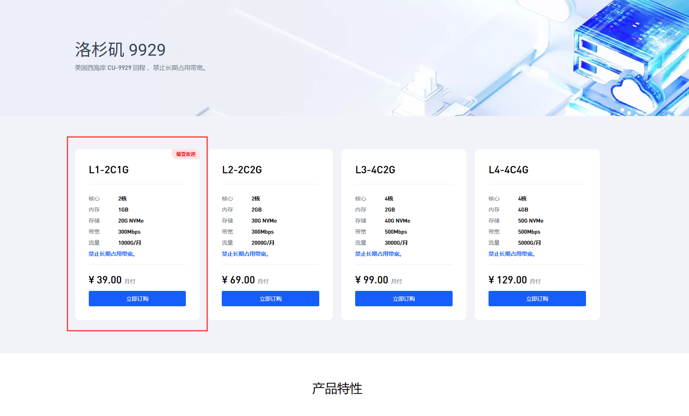
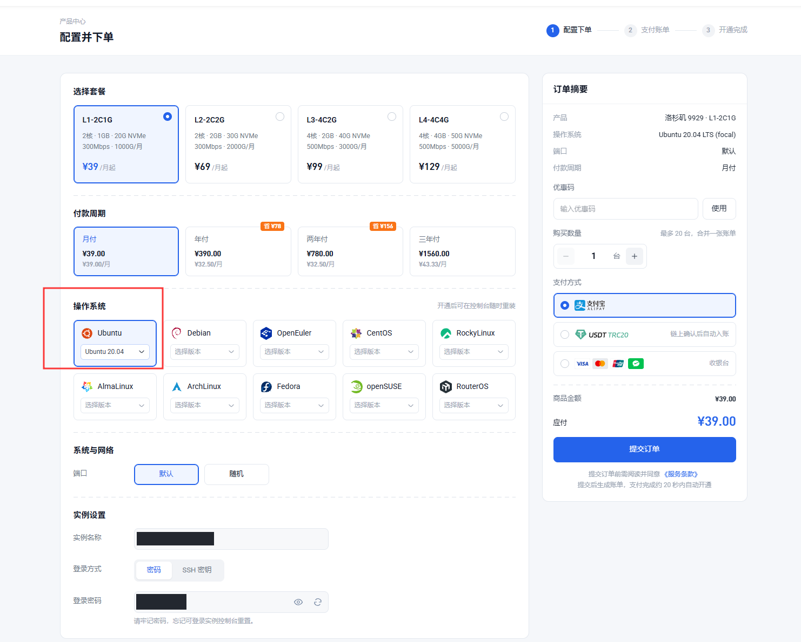
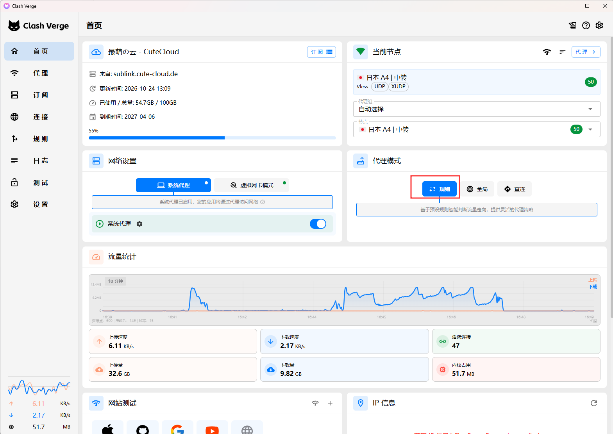
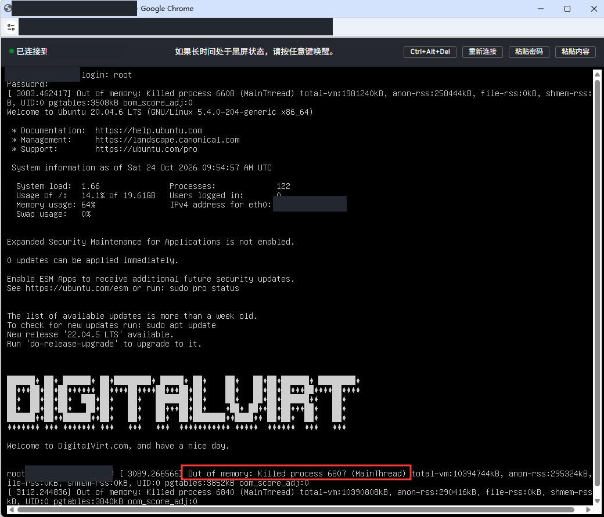
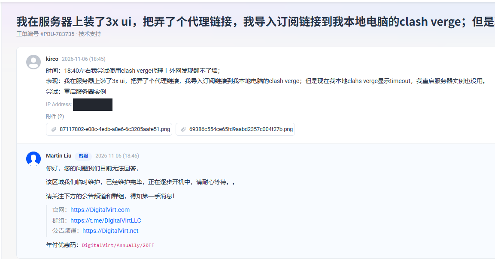
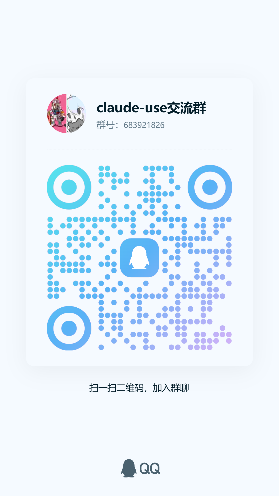

# Claude Code 中文上手教程

简体中文 · [English](README.en.md)

我把上手过程写成了三步。要在自己有权配置的网络上自建代理，就从第 1 步开始。网络已经能正常连接的，直接看第 3 步开通 Pro 和登录 Claude Code。

## 1. 买一台 VPS

**租服务器的地址（推广链接）**　<https://digitalvirt.com/aff.php?aff=1572>

1. 打开链接后，在产品列表找 **洛杉矶 9929**。下面红框里就是 **39 元/月** 的入门档。要是这档售罄，又想马上开通同一条线路，就选还有库存的更高价档；39元没有，就只能买更贵的了。下单时以商品页的价格和库存为准。

   

2. 进到下单页，在 **操作系统** 里选 **Ubuntu**。确认服务商提供网页控制台，再选付款周期、完成下单。SSH 连不上时，可以从网页控制台查看服务器状态。

   

3. 开通后，在服务商的控制台找到服务器地址、SSH 端口和登录信息。先从自己电脑用 SSH 连进去，也可以通过网页控制台打开终端。确认能登录再装面板。

## 2. 用 3x-ui 导出订阅，再导入 Clash Verge

1. **装面板。** 在你管理的 VPS 上按项目说明安装 **3x-ui**。登录面板，为自己的设备配置入站和客户端，确认 Xray 正常运行。（不会装的话，让你的Agent帮你装，prompt:我已经ssh连接好的我的美国云服务器了，帮我往云服务器上装个开源的3x-ui，然后给出导出流量的订阅链接，我复制到本地的clash verge导入流量）

   - 安装 3x-ui　<https://github.com/MHSanaei/3x-ui/wiki/Installation>
   - 入站配置　<https://github.com/MHSanaei/3x-ui/blob/main/docs/content/docs/en/config/inbounds.mdx>

2. **复制订阅。** 到 **面板设置 → 订阅** 打开订阅服务，再从客户端条目复制对应的 **订阅链接**。面板提供 Clash 格式时选这个格式。这个链接会把节点配置交给 Clash Verge，留在自己的设备上用。

   - 订阅设置　<https://github.com/MHSanaei/3x-ui/wiki/Common-questions-and-problems#13-how-does-the-panel-subscription-link-work>

3. **导入并启用。** 在电脑上安装 **Clash Verge Rev**，打开 **订阅** 页，粘贴链接、导入并选中新配置。到 **代理** 页确认能看到节点，在首页按图选 **规则** 模式，再开启 **系统代理**。先用浏览器打开一个你有权访问的站点，到连接列表确认规则有没有生效。

   - 下载 Clash Verge Rev　<https://www.clashverge.dev/install.html>
   - 导入订阅　<https://www.clashverge.dev/guide/profile.html>

   

## 3. 开通 Pro，登录 Claude Code

1. **开通 Pro。** 直接找tb的商家，买一个过KYC的pro成品号。

2. **用同一个账号登录 Claude Code。** Pro 生效后，如果你用桌面端，从官网下载 Claude Desktop，登录后打开 **Code** 标签，选一个项目文件夹。如果你用终端，按官方文档装好 CLI，在项目目录里运行 `claude`，按提示用同一个账号登录。

   - 桌面端下载　<https://claude.com/download>
   - CLI 快速入门　<https://code.claude.com/docs/en/quickstart>
   - Pro 与 Claude Code　<https://support.claude.com/en/articles/11145838-use-claude-code-with-your-pro-max-or-ultra-plan>

## 卡住了就从失败的那一步查

| 遇到的问题 | 下一步怎么查 |
| --- | --- |
| SSH 反复掉线 | 先从服务商的网页控制台进 VPS。用 `free -h` 看内存，用 `sudo journalctl -k --since today` 查掉线前后有没有内存不足（OOM）的记录。在内存小的 VPS 上，可以把安装咨询留在自己的电脑上，把服务器的资源留给代理服务。 |
| 订阅导入失败，或导入后没有节点 | 检查 3x-ui 的订阅服务有没有打开、对应的客户端是否启用或已到期，以及本机能不能访问订阅地址。看到证书报错时，核对域名和证书。 |
| 有节点，但延迟一直显示 `timeout` | 检查 VPS 是否在线、服务是否在正确的端口监听、网络规则是否放行。仍然超时时，看服务商公告或提工单，确认机房有没有维护。 |
| 只有 Claude Code 连不上 | 看 Claude 服务状态，确认已经登录开通 Pro 的账号，再检查该客户端的网络设置。使用获准的 HTTP(S) 代理时，CLI 在启动时读取 `HTTPS_PROXY` 或 `HTTP_PROXY`。桌面会话按官方文档配置。 |

- Claude 服务状态　<https://status.claude.com/>
- Claude Code 网络配置　<https://code.claude.com/docs/en/network-config>

对照内存日志和机房维护工单

> **如果你实在不会，就让你的 AI 读一下我的[原始对话记录](docs/chat.md)，让它告诉你下一步怎么做。**

> **总得来说就是：1、先去我推荐的网站租好云服务器（其他可能的云服务器可能也行没试过），ssh连上，让agent帮你装好开源的3x ui，让它agent导出订阅的流量链接，你把流量链接导入clash verge（其他代理软件也行），把clash verge开启系统代理**

> **2、去tb（或者海鲜市场）找一个销量高的商家，买一个已经过kyc的pro成品号（不太推荐新手买20x，因为被封号的代价太大，max 勇者可以尝试一下，我是没米搞）；然后直接登录就正常使用了。**

> **3、注意：一定是过了Kyc的号；并且我的方法并不能保证不会被弹kyc和portal验证和封号，只是交流技术，任何后果与作者无关。**

## 有问题可以进群聊

**Claude 使用交流群（QQ 群号 `683921826`）**。卡在哪一步了，可以带上报错来聊。发截图前记得遮住服务器地址、订阅链接和登录信息。发现文档有过时的地方，也欢迎开 Issue。

## 许可

两份 README 的原创文字采用 CC BY 4.0，欢迎注明出处后转载或改写。聊天记录及图片的权利归各自权利人。[许可全文](LICENSE)

## 交流声明

这篇教程仅供交流，不保证账号一定不被封禁，也不保证不会弹出 KYC 或 Verification Portal。请自行判断并承担使用和操作带来的后果，作者不对这些后果负责。
