# 原始聊天记录

[返回使用指南](../README.md) · [English guide](../README.en.md)

消息按原顺序排，截图和表情包也放回了原来的位置。服务器地址、订阅链接和登录信息已遮挡。方括号标的是少量删节。用到的套餐和账号体验都是当时的记录。两处 DigitalVirt 链接是推广链接。

## 10 月 24 日

**我**

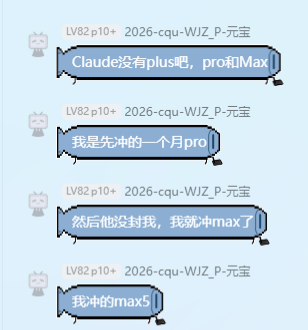

**你好啊**，我最近想体验使用一些claude code的写作效果；想向你请教学习一下经验

**师兄 (WJZ_P)**

我没用过cc写作，我拿来写代码的

**我**

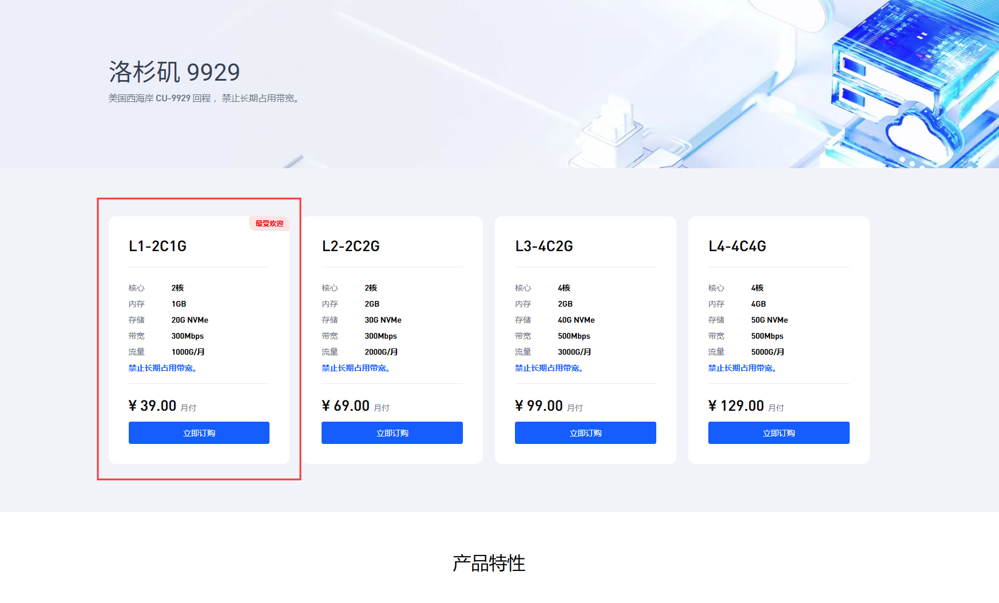

你的cladue 暂时不被封，是主要订阅这个39的流量在clash verge上使用，然后claude code正常的订阅；就这么简单，然后到现在为止还没有被封，对吗

**师兄**

租服务器的网站：[digitalvirt.com/aff.php?aff=1572](https://digitalvirt.com/aff.php?aff=1572)

订阅最便宜的39/month，洛杉矶9929，当然更贵的更好，但是我只给出能用的方法。

**WJZ_P** · 16:37:06

代理软件不是clash

**WJZ_P** · 16:37:08

不过应该无所谓

**WJZ_P** · 16:37:13

流量走代理就行了

**WJZ_P** · 16:37:27

也不确保这样做就不会封，说到底尽人事听天命

**WJZ_P** · 16:37:30

**我**

代理需要开tun模式吗

**WJZ_P** · 16:38:05

不用

**WJZ_P** · 16:38:20

我单独开一个端口，让cc走我那个代理端口出去就行

**唐僧洗头用飘柔** · 16:39:17

cc desktop版可以不，不想用cli写作[笑哭]

**WJZ_P** · 16:39:27

我就是desktop

**WJZ_P** · 16:39:42

让AI给你搞一下，使得启动cc时流量走某个端口就行

**WJZ_P** · 16:39:54

他也是electron or  tauri，浏览器套壳的实现

**WJZ_P** · 16:40:00

启动的时候加个 --http-proxy=xxxx

**WJZ_P** · 16:40:02

大概这样就行了

**唐僧洗头用飘柔** · 16:44:29

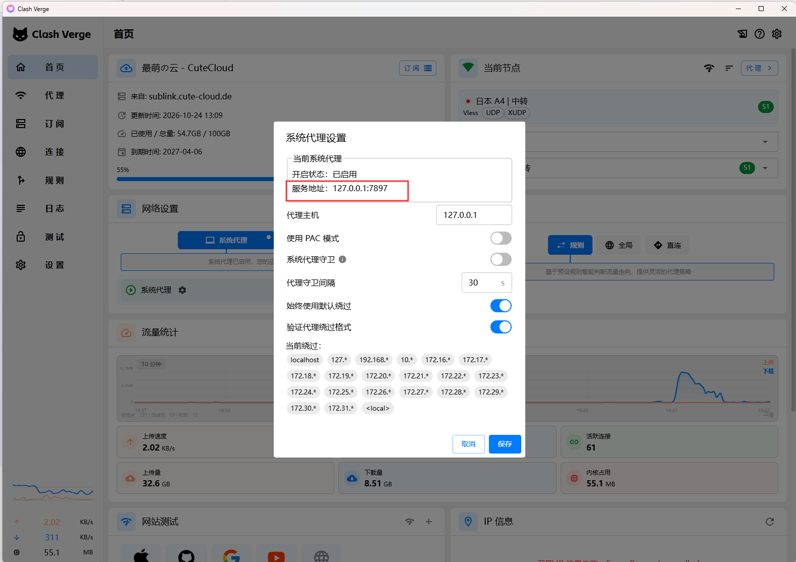

正常开代理在clash里面都是走7897端口，理论上，clash应该会让cc自己走这个代理端口的。我还需要特地按你这个单独弄一个端口,让启动cc时流量走某个端口吗？

**唐僧洗头用飘柔** · 16:46:07

就是我认为直接在clash里面把代理开启就行，你单独开一个端口给cc，是让为了降低封号率吗[疑问]

**WJZ_P** · 16:47:21

不是，我在家就是直接开系统代理的

**WJZ_P** · 16:47:30

然后我公司是只开了一个端口

**WJZ_P** · 16:47:41

因为公司有自己的代理软件，我们用 ioa

**WJZ_P** · 16:47:53

所以我只让 cc 走我代理流量，其他正常走公司流量

**唐僧洗头用飘柔** · 16:48:19

哦哦，我没在实习哈哈，学到了

**WJZ_P** · 16:48:35

我在家就是直接开系统代理的，访问国外 IP 都走代理流量

**唐僧洗头用飘柔** · 16:49:17

我现在还没实习，简单来说就是直接开系统代理就完事了

**唐僧洗头用飘柔** · 16:49:19

对吧

**唐僧洗头用飘柔** · 16:50:19

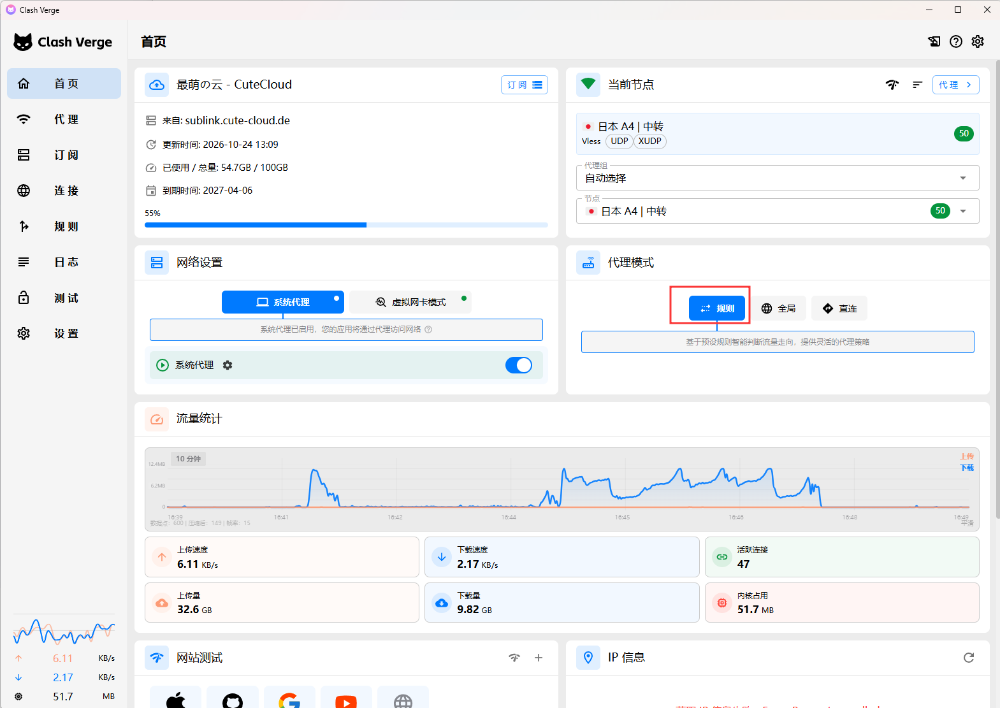

规则模式，都能达到你这个效果了，我理解是

**WJZ_P** · 16:50:27

对

**WJZ_P** · 16:50:39

我在家里就是开的规则

**WJZ_P** · 16:50:41

公司单独搞个端口

**WJZ_P** · 16:50:55

不然如果全部流量都走我代理，不合规

**唐僧洗头用飘柔** · 16:51:26

我去试试，看看a封不封我号[笑哭]

**WJZ_P** · 16:52:49

可以先开个 pro 试试

**唐僧洗头用飘柔** · 16:53:12

嗯，tk

**WJZ_P** · 16:53:13

看看有没有事，没事再开 max5

**WJZ_P** · 16:53:16

成本有点高的

**WJZ_P** · 16:53:19

七八百一个 max

**唐僧洗头用飘柔** · 16:55:43

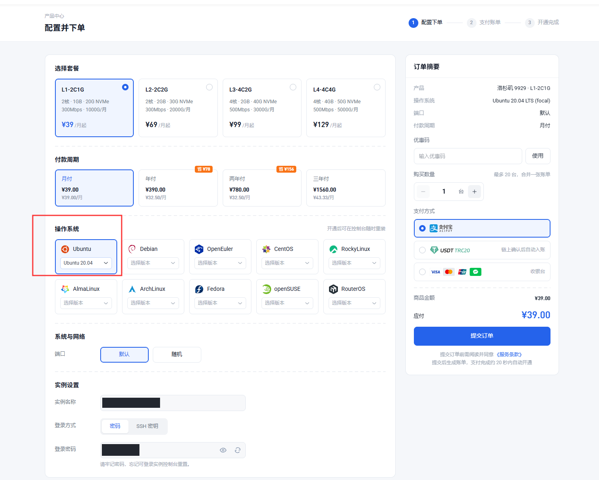

**唐僧洗头用飘柔** · 16:55:53

这个ubuntu可以的吧

**WJZ_P** · 16:56:05

我就是 Ubuntu

**唐僧洗头用飘柔** · 16:56:11

😁

**WJZ_P** · 16:56:47

搭个 3xui，点几下就可以导出成订阅地址了

**唐僧洗头用飘柔** · 16:57:47

我先去买个claude pro 号试试

**WJZ_P** · 16:57:58

你有谷歌账号吗

**WJZ_P** · 16:58:04

自己的谷歌账号注册一个也可以

**WJZ_P** · 16:58:11

我前面封的三个都是成品号

**WJZ_P** · 16:58:18

现在这个是我自己谷歌账号注册的

**唐僧洗头用飘柔** · 16:58:35

有，但是我订阅过程可能有点难

**WJZ_P** · 16:58:51

淘宝找代充

**WJZ_P** · 16:59:01

[付款链接转交方式略]

**WJZ_P** · 16:59:05

**唐僧洗头用飘柔** · 16:59:20

奥icic

**唐僧洗头用飘柔** · 16:59:23

tk

**WJZ_P** · 16:59:25

我这个号一直是代充

**唐僧洗头用飘柔** · 17:01:42

我应该先买流量，要不然登上去还没充pro就被封了

**WJZ_P** · 17:01:54

**唐僧洗头用飘柔** · 17:36:44

群u，这个Digitalvirt我还不太会用；我怎么导出成订阅地址？我现在已经ssh连上服务器了，并且装上codex了；我还不太明白为什么我租一点美国的服务器，能导出订阅地址；这个能详细点吗？或者有什么我可以让ai帮我做的不

**唐僧洗头用飘柔** · 17:36:59

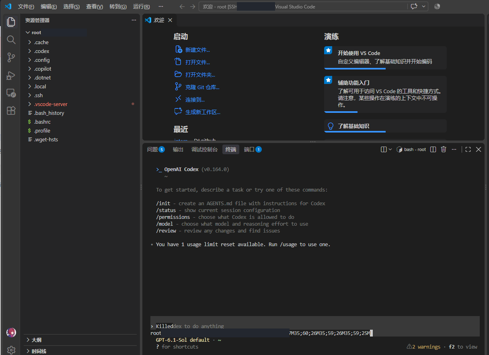

**WJZ_P** · 17:37:03

他会给你一个 IP地址，和账号密码

**WJZ_P** · 17:37:07

你先用 ssh 登录上去

**WJZ_P** · 17:37:18

然后问 ai 如何使用 3x ui

**WJZ_P** · 17:37:38

实际就是你连上服务器的 SSH 终端后，敲几个命令就能把面板安装好

**WJZ_P** · 17:37:50

然后直接访问网站对应端口，就有 WebUI 了

**WJZ_P** · 17:38:02

ai 基本都会的，我当初是 Gemini 教我的

**唐僧洗头用飘柔** · 17:40:01

3x ui是这个Digiyaxxx已经在服务器里面装好了吗？我只需用它的WebUI，还是要自己装，自己用

**WJZ_P** · 17:40:24

3x ui 说一个 GitHub 开源的可视化订阅链接制作服务

**WJZ_P** · 17:40:28

你不是有 codex 吗

**WJZ_P** · 17:40:43

直接问 codex 怎么在 Linux 上安装 3x ui 就行

**唐僧洗头用飘柔** · 17:41:21

我服务器上应该本身不需要装代理，本身就在美国了

**WJZ_P** · 17:41:39

是不需要

**WJZ_P** · 17:42:03

你只是需要用 3x ui 导出一个节点链接，使得你可以一键导入 clash 等代理软件用

**唐僧洗头用飘柔** · 17:42:32

ok懂了

**唐僧洗头用飘柔** · 17:42:34

通透！

**WJZ_P** · 17:42:48

**唐僧洗头用飘柔** · 17:43:17

我还是得自己下载，这个Digiyxx本身是没有的吧

**唐僧洗头用飘柔** · 17:43:24

3x ui

**WJZ_P** · 17:43:28

自己装

**WJZ_P** · 17:43:34

你现在手上有能用的 AI 不

**WJZ_P** · 17:43:51

直接问他怎么装就行，或者你去 3x ui 的 GitHub 官网看 README

**WJZ_P** · 17:43:56

就是一行指令的事

**唐僧洗头用飘柔** · 17:44:16

嗯，我有codex能用，正在尝试让它帮我干

**WJZ_P** · 17:44:35

他应该会的，我当时用的 Gemini argon4 教我

**WJZ_P** · 17:44:37

他就会

**唐僧洗头用飘柔** · 17:46:50

但是这个ssh老是断开你有这个问题吗，不稳定,是我在本地电脑开代理的原因吗

**WJZ_P** · 17:47:01

我没有断开过

**WJZ_P** · 17:47:09

他网站上本身也提供连接服务的

**WJZ_P** · 17:47:16

就一个浏览器窗口，用那个试试

**唐僧洗头用飘柔** · 17:47:21

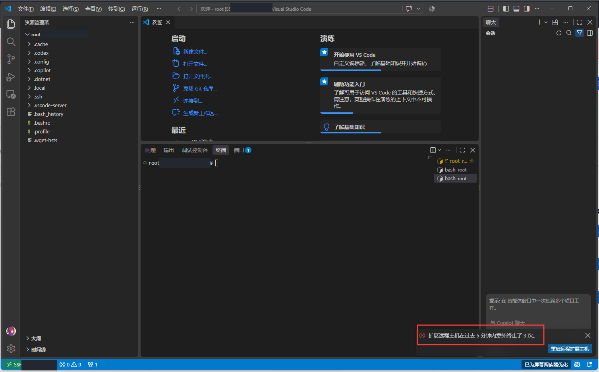

**WJZ_P** · 17:47:46

进入到服务器控制面板

**WJZ_P** · 17:48:07

他有个连接按钮，你在浏览器里面打指令就行，跟 ssh 一样的

**唐僧洗头用飘柔** · 17:57:23

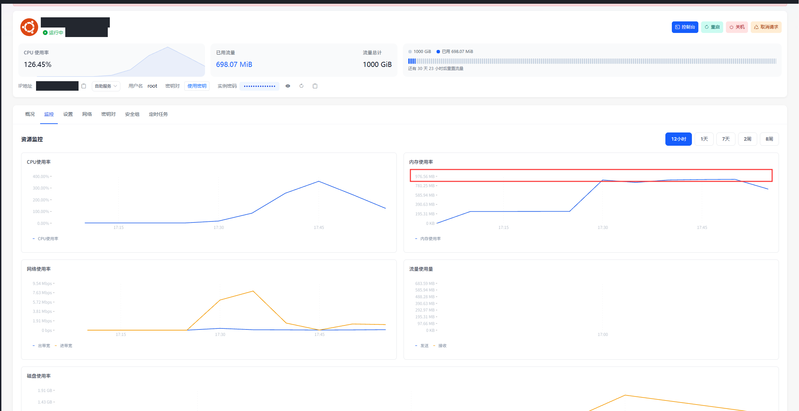

**唐僧洗头用飘柔** · 17:57:58

哈喽，你服务器上装codex了吗，我这个服务器经常掉的原因好像是codex占满内存了（总共1GB）

**WJZ_P** · 17:58:08

没有呀

**WJZ_P** · 17:58:13

服务器上装codex 干啥

**WJZ_P** · 17:58:20

你自己电脑上装一个

**WJZ_P** · 17:58:29

让他连服务器给你操作不就好了吗

**WJZ_P** · 17:58:36

为啥要直接装服务器上

**WJZ_P** · 17:58:40

**唐僧洗头用飘柔** · 17:59:45

靠我重装系统吧，我好像进不去服务器了，太卡了[捂脸]

**唐僧洗头用飘柔** · 18:00:49

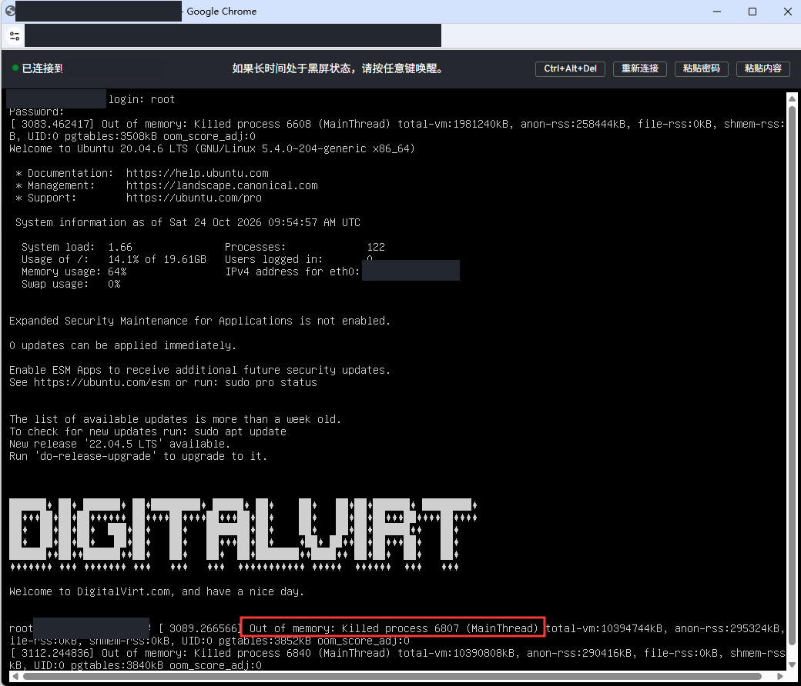

**唐僧洗头用飘柔** · 18:00:51

难绷

**WJZ_P** · 18:01:12

重装就行，不会花太久

**唐僧洗头用飘柔** · 18:02:15

哈哈哈

**WJZ_P** · 18:02:40

没事这一套流程你走完就记得了，以后可以教你的师兄们

**WJZ_P** · 18:02:47

我第一次也是跟 Gemini 搞大半个小时的

**WJZ_P** · 18:02:50

**唐僧洗头用飘柔** · 18:03:46

还得仰仗大佬，很难想象你之前自己摸索怎么做的(ᐛ )👍

**WJZ_P** · 18:04:44

之前我帮同学搞，买的是单纯的家宽，是不能直连的，因为他是美国的 IP，大陆连不上

**WJZ_P** · 18:04:49

就要走链式代理

**WJZ_P** · 18:05:05

先用一个能连上的代理做第一跳，第二跳再连到家宽上

**WJZ_P** · 18:05:12

但是 digitalvirt 他这个处理过

**WJZ_P** · 18:05:24

入站流量可以直连上，出站是美国

**WJZ_P** · 18:05:47

不需要走链式代理，方便

**唐僧洗头用飘柔** · 18:11:07

群友看看能不能登上，我一直ssh登不上

**唐僧洗头用飘柔** · 18:11:39

流量随便用，我就开了一个月的

**唐僧洗头用飘柔** · 18:11:45

方便的话

**WJZ_P** · 18:12:25

我在外面

**WJZ_P** · 18:12:33

暂时不在家里

**WJZ_P** · 18:12:41

会不会是代理之类的问题

**WJZ_P** · 18:12:56

可以问问 codex ssh 怎么带代理地连接远程服务器

**唐僧洗头用飘柔** · 18:14:09

嗯我问问

**唐僧洗头用飘柔** · 18:35:56

成功了，群u有需要可以使用这个流量，1个月的，反正我应该也用不完

**WJZ_P** · 18:36:15

我买的一年的，应该不用

**唐僧洗头用飘柔** · 18:37:15

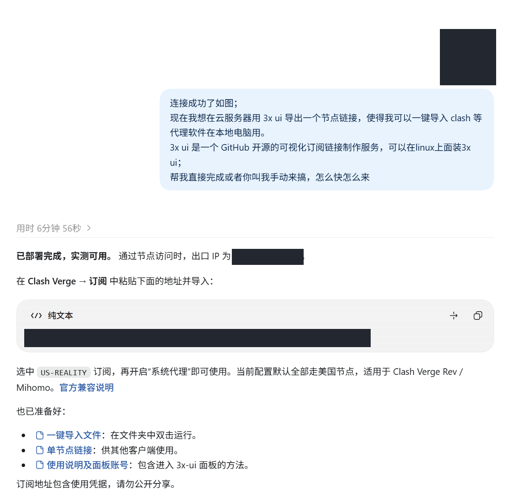

还真是prompt工程师

**WJZ_P** · 18:37:25

**唐僧洗头用飘柔** · 18:55:54

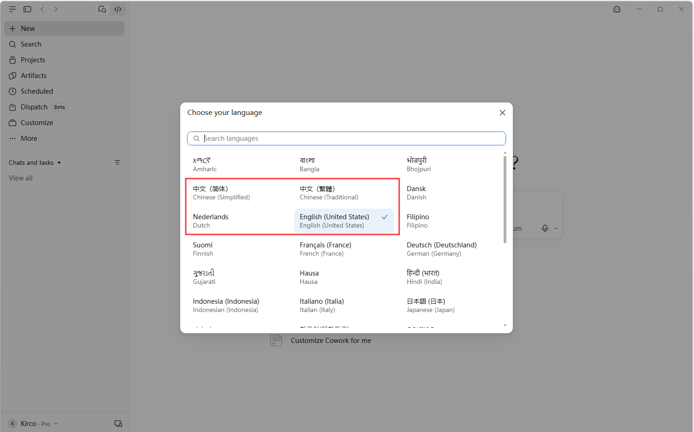

**唐僧洗头用飘柔** · 18:56:14

这个calude code desktop怎么有中文语言选择，是钓鱼吗

**WJZ_P** · 18:57:43

最近更新出了中文

**WJZ_P** · 18:57:47

不确定是否是钓鱼

**WJZ_P** · 18:57:50

反正我不选

**WJZ_P** · 18:58:03

但我手机之前有一次不小心没开代理连了

**WJZ_P** · 18:58:08

自动变成中文了

**WJZ_P** · 18:58:09

**唐僧洗头用飘柔** · 19:00:04

ok，谢谢你，我最近在赶论文，试试claude写作

**唐僧洗头用飘柔** · 19:00:29

交个彭友，保持交流[坏笑]

## 11 月 6 日

**唐僧洗头用飘柔** · 18:36:18

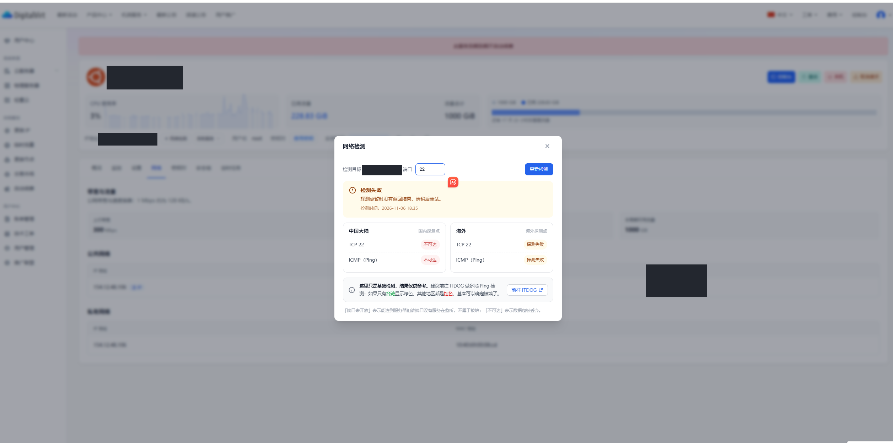

**唐僧洗头用飘柔** · 18:36:46

哈喽你好，这个网站一般稳定吗，怎么现在代理红了[坚强]

**WJZ_P** · 18:36:53

找客服问问看

**WJZ_P** · 18:37:01

我之前卡了一周

**WJZ_P** · 18:37:08

和我说服务器核心出毛病了

**WJZ_P** · 18:37:12

**WJZ_P** · 18:37:30

我朋友买的 79 一个月的就一直没事

**唐僧洗头用飘柔** · 18:38:22

这样嘛，我试着重启看看有没有用

**唐僧洗头用飘柔** · 18:46:49

靠重启没有用，clash verge 还是timeout；

**唐僧洗头用飘柔** · 18:46:59

这个工单我怎么感觉很慢的样子

**WJZ_P** · 18:47:12

小时级回复

**WJZ_P** · 18:47:33

你可以让他帮你直接换个节点区域，但是 IP 会变

**唐僧洗头用飘柔** · 18:48:43

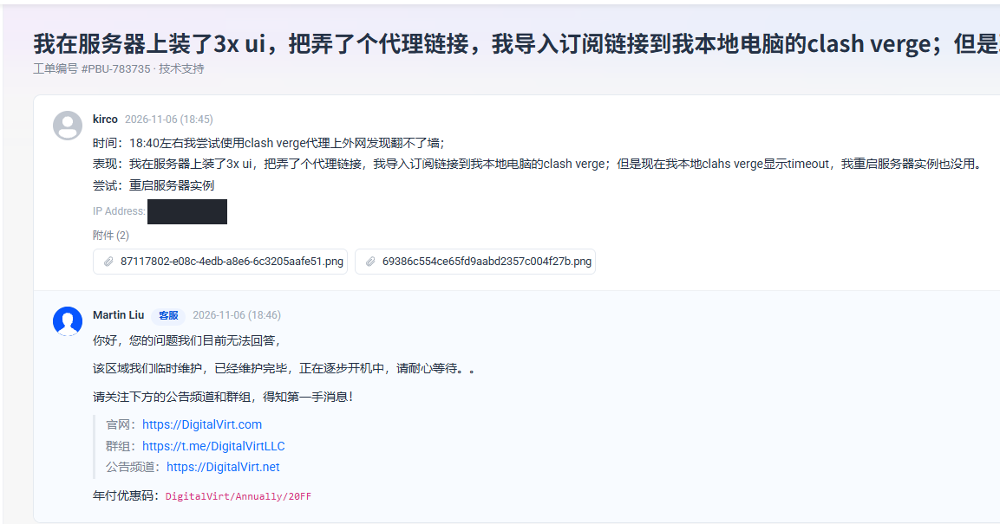

**唐僧洗头用飘柔** · 18:48:49

还挺快，就是好像没啥用

**WJZ_P** · 18:49:05

**唐僧洗头用飘柔** · 18:49:37

靠，好了

**唐僧洗头用飘柔** · 18:50:06

这效率，我收回之前的话[笑哭]

**WJZ_P** · 18:50:15

## 11 月 16 日

**唐僧洗头用飘柔** · 21:53:04

哈喽，最近claude还能用吗

**WJZ_P** · 21:53:09

可以

**唐僧洗头用飘柔** · 21:53:37

我今天被弹2个门户验证了，不知道是不是服务器代理还是我问的内容

**唐僧洗头用飘柔** · 21:53:42

[流泪]

**WJZ_P** · 21:53:52

为啥是2个呀，你是两个号吗

**WJZ_P** · 21:54:03

我同事有一位也是出了kyc

**WJZ_P** · 21:54:12

[第三方代办验证的操作建议略]

**WJZ_P** · 21:54:17

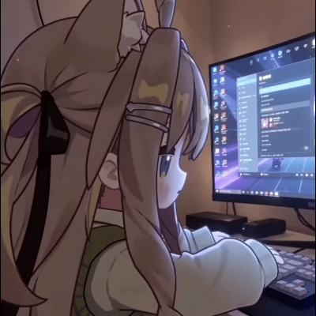

**唐僧洗头用飘柔** · 21:56:14

哈哈哈，我以为是服务器那边的问题，所以来问问你

**WJZ_P** · 21:59:00

**WJZ_P** · 21:59:03

我和我朋友目前正常

**WJZ_P** · 21:59:08

我们都是两个多月

**唐僧洗头用飘柔** · 22:03:17

ok，可能是我让claude code调用codex的原因弹门户验证多

**WJZ_P** · 22:03:46

你是一个电脑两个号吗

**WJZ_P** · 22:03:54

那个验证一个号只会弹一次吧

**WJZ_P** · 22:04:01

过了之后就不会弹了

**唐僧洗头用飘柔** · 22:04:47

我不太清楚耶，问淘宝商家这个验证要360

**WJZ_P** · 22:04:57

我当时 280

**WJZ_P** · 22:05:06

不过 kyc 的话后续就不能使用了

**WJZ_P** · 22:05:13

**WJZ_P** · 22:05:24

你后面如果需要充值 max 也必须先过 kyc

**WJZ_P** · 22:05:28

不然他们不给你充

**唐僧洗头用飘柔** · 22:05:44

**唐僧洗头用飘柔** · 22:06:03

我是这个，这个好像是叫KYC吗？我怎么翻译是门户验证

**WJZ_P** · 22:06:07

就是这个

**WJZ_P** · 22:06:12

know your customer

**WJZ_P** · 22:06:19

一个意思

**WJZ_P** · 22:06:33

然后 Claude 使用第三方服务 persona 来对你进行验证

**WJZ_P** · 22:06:40

我当时[验证链接转交方式略]

**WJZ_P** · 22:06:42

他帮我过

**WJZ_P** · 22:06:43

**唐僧洗头用飘柔** · 22:10:30

一样吗， 我怎么看商家和我说有门户验证和Kyc

**WJZ_P** · 22:10:36

**WJZ_P** · 22:10:46

那信商家的

**WJZ_P** · 22:10:51

可能是新加的

**WJZ_P** · 22:10:55

我是两个月前过的

**唐僧洗头用飘柔** · 22:15:17

这个还有吗

**唐僧洗头用飘柔** · 22:15:45

帮我找找你当时付款的商家，或者搜索关键词我去看看

**WJZ_P** · 22:15:52

跑路了

**WJZ_P** · 22:15:56

已经不在了

**WJZ_P** · 22:15:59

**唐僧洗头用飘柔** · 22:17:22

好吧

**唐僧洗头用飘柔** · 22:37:55

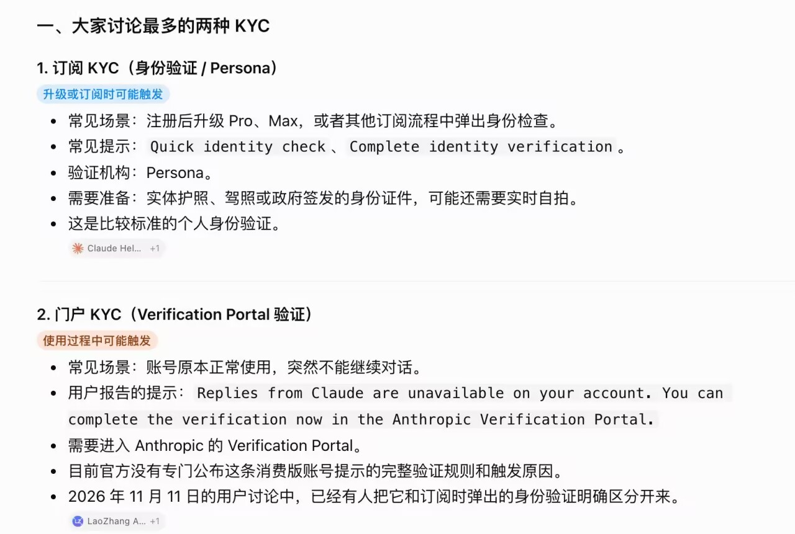

**唐僧洗头用飘柔** · 22:38:23

太有讲究了，不过弹的是第 2 种，商家说贵[微笑][微笑][微笑]

**WJZ_P** · 22:38:57

**WJZ_P** · 22:39:01

应该是新加的

**WJZ_P** · 22:39:05

我当时没有这个

**唐僧洗头用飘柔** · 22:42:15

靠，真实

**唐僧洗头用飘柔** · 22:42:23

被A\真实了

**WJZ_P** · 22:47:27

12号开始实施了更严厉的管控措施

**唐僧洗头用飘柔** · 22:58:10

就还是租那个网站的服务器导出流量，然后就过了Kyc然后你们就一直在使用了？

**WJZ_P** · 23:10:50

是啊

**WJZ_P** · 23:10:54

**唐僧洗头用飘柔** · 23:12:38

ok，那可能还得是必须先过一遍Kyc或者portal才能正常用了

**唐僧洗头用飘柔** · 23:13:11

我之前没过Kyc，也没过最近加的这个portal[大怨种]

**唐僧洗头用飘柔** · 23:50:22

我知道了，我之前2个号被弹portal的原因：

主要是我的号没有过kyc，其次才是我的使用习惯。

现在我的号是[第三方账号购买方式略]，350RMB左右+之前在租美国服务器导出订阅流量在clash verge里面使用。现在为止用了差不多一个月来25+天了，还是蛮稳定的，没有弹kyc/portal也没有被封号。

租服务的网站是：[digitalvirt.com/aff.php?aff=1572](https://digitalvirt.com/aff.php?aff=1572)

最便宜的是39/月的如图：

洛杉矶 9929 hot 美西精品网、四网回程 9929

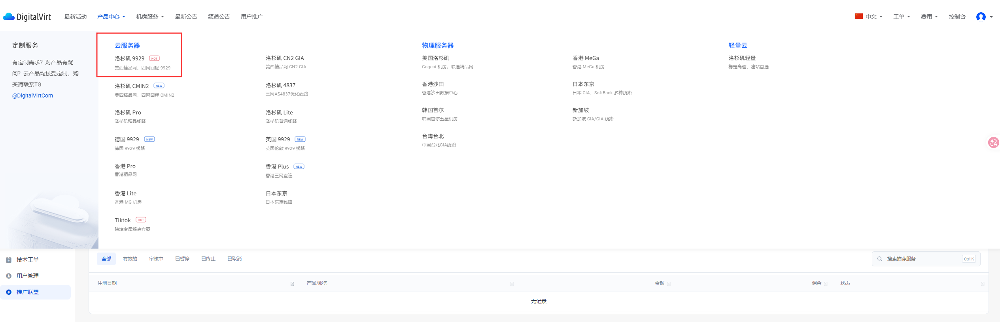

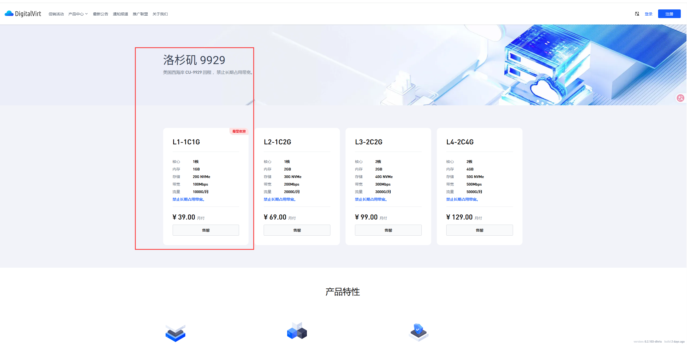
